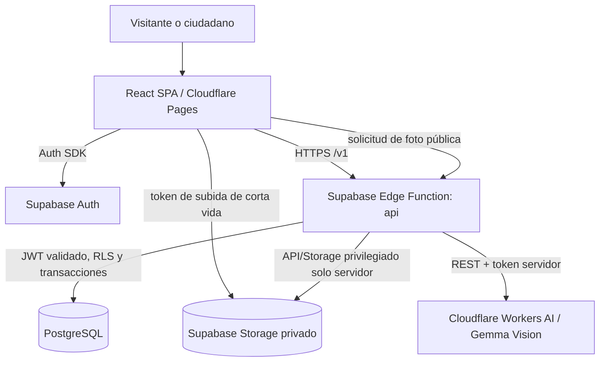

# Architecture — Beta pública del hackathon

**Estado:** diseño aprobado (2026-10-10). **Fase:** System Design; **sin implementación**.  
**Fuentes funcionales:** [concepto](../ideas/product-concept.md) · [mapa](../specs/capability-map.md) · [RQs del producto completo](../requirements/mvp-requirements.md).

## 1. Objetivo y decisiones

Publicar una beta web para adultos en España que permita registrar dos tipos de buenas acciones, revisar una fotografía con IA, otorgar puntos solo tras aprobación, consultar ranking/feed y retirar publicaciones. Tres desarrolladores supervisan agentes de IA. Infraestructura y API de IA **sin coste de suscripción ni consumo de pago**, dentro de cuotas gratuitas; ocho horas como horizonte inicial del hackathon.

**Arquitectura aprobada:** aplicación **serverless modular**, cinco módulos lógicos, un único backend HTTP; ni microservicios ni servidor autogestionado.

| Capa | Elección | Límites/propósito |
|---|---|---|
| Web | React + Vite + TypeScript; Tailwind + shadcn/ui | SPA responsive; interfaz no confiable |
| Hosting | Cloudflare Pages Free (`*.pages.dev`) | No requiere dominio propio |
| API / orquestación | Supabase Edge Functions (Deno/TypeScript) | Función `api` con rutas versionadas; autenticación/autorización y reglas |
| Datos | Supabase PostgreSQL Free + Auth + Storage privado | Transacciones, RLS, contraseñas solo en Auth |
| IA visual | Cloudflare Workers AI, `@cf/google/gemma-4-26b-a4b-it` | **Seleccionado condicionalmente**: demostrar acceso Free, licencia, privacidad, calidad y coste 0 antes de recibir fotos reales |
| Antibots | Cloudflare Turnstile + protecciones de Auth | Verificar tokens **en servidor**, limitar abuso; sin servicio de correo |

Flujo de dependencias conceptual: `identity` + `ai-validation` → `contributions` → `scoring` + `community`. Los módulos son carpetas/contratos, **no procesos independientes**.

## 2. Topología y fronteras



**Fronteras de confianza:** el navegador nunca aporta `userId` confiable, estado de aprobación ni puntos; tampoco conoce secretos de Workers AI o la clave `service_role`. Todas las transiciones se aplican en funciones/RPC transaccionales. Las fotos originales y versiones sin metadatos permanecen privadas. El endpoint de medios comprueba visibilidad en cada petición; no se publican URLs permanentes de Storage.

## 3. Recorrido de una contribución

1. Usuario autenticado (correo + contraseña, **sin confirmación de email**) declara ≥18 años y posee alias único. Selecciona `RECYCLING` (10) o `LITTER_COLLECTION` (20), municipio INE, fotografía y descripción.
2. `POST /v1/uploads` asigna ruta de Storage privada y token de subida acotado; el navegador carga el archivo. `POST /v1/contributions` **valida en servidor** imagen, tipo, municipio, descripción, EXIF para fotos de galería y permisos de la ruta. La captura de cámara debe realizarse desde el flujo de cámara en la web (sin pretender prueba infalsificable del origen).
3. Una transacción PostgreSQL bloquea el par usuario/tipo, comprueba cooldown y pendiente existente, fija `submitted_at` UTC y `points_snapshot`, inserta `PENDING`. Devuelve `202` con ID. No hay publicación ni puntos aún.
4. Una función intenta procesar la contribución en segundo plano (`waitUntil`) tras **adquirir una reserva/versión atómica**. Lee imagen privada, consulta IA, valida estrictamente su respuesta, prepara imagen apta para publicación **sin EXIF/ubicación** y completa una transición protegida: `APPROVED`, `NEEDS_EVIDENCE`, `REJECTED` o `TECHNICAL_ERROR`. No se aprueba ante errores ni certeza insuficiente.
5. La UI consulta el estado (polling). `APPROVED` + `hidden_at IS NULL` habilita feed y puntos. El autor puede cancelar un trabajo no resuelto, reintentar error o aportar nueva evidencia en el **mismo registro**; ocultar una aprobación revoca inmediatamente puntos y acceso público.
6. Feed/ranking se calculan a partir de registros aprobados **no ocultos**, sin saldos incrementales; los Me gusta no influyen en puntuación.

### Consistencia y recuperabilidad

- **Sin cola durable en la beta:** `EdgeRuntime.waitUntil` está sujeto a límites de ejecución. Cada procesamiento usa `validation_version` + reserva temporal (`processing_lease_until`) y una actualización condicional. Si queda bloqueado, al vencer la reserva el autor ve **Reintentar**, que reclama una nueva reserva; no se autoaprueba ni se factura por encima del plan gratis. Estado de error visible, nunca “aprobado” optimista.
- **Una pendiente por usuario+acción:** se consideran sin resolver `PENDING`, `NEEDS_EVIDENCE`, `TECHNICAL_ERROR`. La base de datos impide dos simultáneas incluso con doble clic. Cancelar libera bloqueo; una respuesta tardía de IA no cambia estado.
- **Cooldown:** 60 min desde `submitted_at` de la **última contribución aprobada** del usuario para ese tipo, independientemente de municipio. Se aplica tanto a nuevas contribuciones como tras ocultar: ocultar **no elude cooldown**. Rechazadas/canceladas no lo activan.
- **Idempotencia:** repetición de `Idempotency-Key` del mismo usuario/intento devuelve el mismo resultado. Un `APPROVED` no puede otorgar dos veces puntos (se derivan de filas, no de efectos de incremento).
- **Fotos retiradas:** bloqueo inmediato de nuevas peticiones a medios; la cache del navegador o copias realizadas antes de ocultar no son revocables retroactivamente. Cabeceras `Cache-Control: no-store` para minimizarlo.

## 4. Seguridad mínima exigible en beta pública

- Auth real, RLS restringida, claves de servidor solo en secretos de funciones, CORS limitado a Pages/desarrollo. Protección Turnstile en registro y denuncias, controles de tasa en puntos de abuso; nunca confiar en tokens CAPTCHA sin verificación en servidor.
- Storage privado, control de tipo real/MIME y peso de imagen, validación de EXIF del original en backend; publicar **solo representación saneada sin metadatos**. Una imagen manipulada, EXIF y cámara web no prueban autoría; IA comprueba plausibilidad, no certifica verdad.
- Feed público anónimo **solo** para contribuciones aprobadas y visibles; correo jamás público. El autor puede ocultar; existe denuncia anónima y tratamiento manual seguro por un miembro del equipo usando consola administrativa, sin interfaz adicional.
- Información básica de privacidad, responsable/contacto real y mecanismo para ejercer derechos y solicitar retirada. No publicar imágenes de terceros identificables sin base adecuada. El equipo debe revisar licencia y tratamiento de imágenes del proveedor y cumplir las obligaciones aplicables; una beta pública **no está exenta**.
- Ausencia de verificación email: riesgo aceptado **solo para beta** (direcciones no fiables, suplantación y recuperación no automatizada). No activar envíos SMTP ni recuperación por correo en esta entrega. Véase [ADR-002](decisions/ADR-002-auth-sin-confirmacion.md).

## 5. Organización técnica orientativa (no creada)

```
src/                     # SPA, servicios API tipados y vistas
  features/identity/
  features/contributions/
  features/scoring/
  features/community/
  shared/
supabase/functions/api/    # rutas, adaptadores, aplicación y lógica de IA
supabase/migrations/     # tablas, restricciones, RLS y RPC
src/test/                # unitarias del frontend; pruebas backend separadas
e2e/                     # recorridos públicos y del autor
docs/                    # requisitos, specs, diseño y ADR
```

El adaptador de IA vive en el backend; los contratos de módulos se comparten como tipos para evitar divergencias. Comandos objetivo, una vez configurados: `npm run dev`, `npm run build`, `npm run lint`, `npm test`, `npm run test:e2e`. **No verificados contra un repositorio de código.**

## 6. Límites y evolución

No se implementan OAuth, email de recuperación, panel moderador, rankings municipales/semanales, audio, analítica, colas durables, gestión de catálogo ni mecanismo antifraude fuerte. El diseño preserva `municipality_code`, `submitted_at` y `points_snapshot` para evolucionar sin reescribir la contribución.

**No equivalente a salida autorizada:** antes de abrir la beta deben superar los controles de [release-checklist](release-checklist.md), especialmente proveedor IA, saneamiento de imágenes, controles de acceso, moderación y privacidad. Ninguno de esos controles ha sido probado en un entorno real al redactar este documento.

## Referencias técnicas (consultadas 2026-10-10)

- [Supabase: routing en Edge Functions](https://supabase.com/docs/guides/functions/routing)
- [Supabase: background tasks y límites](https://supabase.com/docs/guides/functions/background-tasks)
- [Supabase: control de acceso Storage](https://supabase.com/docs/guides/storage/security/access-control)
- [Cloudflare: Workers AI, modelo Gemma 4 Vision](https://developers.cloudflare.com/workers-ai/models/gemma-4-26b-a4b-it/)
- [Cloudflare: cuota diaria Workers AI](https://developers.cloudflare.com/workers-ai/platform/pricing/)
- [Cloudflare: tratamiento de datos Workers AI](https://developers.cloudflare.com/workers-ai/platform/data-usage/)
