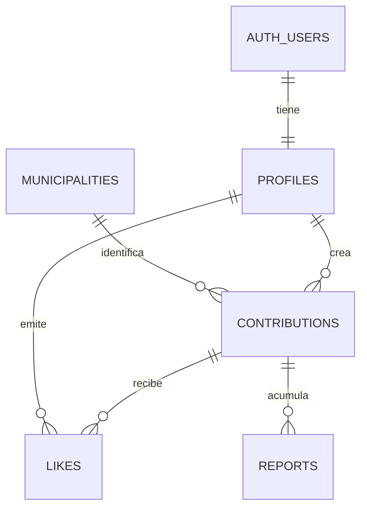

# Modelo de datos — Beta pública

**Estado:** diseño aprobado, implementación pendiente. **Motor:** Supabase PostgreSQL. El esquema es un contrato semántico; no sustituye las migraciones SQL ni las pruebas RLS.

## 1. Entidades y relaciones



| Tabla | Clave/campos esenciales | Regla |
|---|---|---|
| `profiles` | `user_id uuid PK/FK auth.users`, `alias text UNIQUE` (normalización sin distinguir mayúsculas), `adult_declared_at timestamptz NOT NULL`, `created_at` | El email/password permanece en Supabase Auth; alias público |
| `municipalities` | `code text PK`, `name`, `province_name` | Catálogo oficial de municipios de España importado desde fuente INE; no se inventan códigos. En la beta solo se cargan los municipios de la provincia de Barcelona (CPRO 08). |
| `contributions` | `id uuid PK`, `author_id FK`, `action_type`, `description`, `municipality_code FK`, `evidence_path`, `public_photo_path NULL`, `capture_origin`, `capture_exif_at NULL`, `status`, `points_snapshot`, `submitted_at`, `approved_at NULL`, `hidden_at NULL`, `ai_reason NULL`, `validation_version integer`, `processing_lease_until NULL`, `idempotency_key` | Un envío lógico, una aprobación como máximo; tiempo y puntos snapshot inmutables |
| `likes` | `user_id FK`, `contribution_id FK`, `created_at`, PK compuesto (`user_id`, `contribution_id`) | Un Me gusta por usuario/contribución; no propio |
| `reports` | `id uuid PK`, `contribution_id FK`, `reason`, `created_at`, `reviewed_at NULL`, `resolution NULL` | Denuncia anónima, datos mínimos, solo administración puede consultar todas |

**Storage, no tablas extras de dominio:** bucket privado `evidence-private` para originales y `published-private` para copias saneadas. No exponer los paths internos en respuestas públicas. Las credenciales de Auth y contraseñas nunca se copian a `profiles`.

## 2. Tipos y estados

- `action_type`: `RECYCLING` (10 puntos), `LITTER_COLLECTION` (20 puntos). **Valor de `points_snapshot` fijado por servidor al insertar**; no viene del cliente.
- `status`: `PENDING`, `NEEDS_EVIDENCE`, `TECHNICAL_ERROR`, `APPROVED`, `REJECTED`, `CANCELLED`.
- `capture_origin`: `GALLERY` o `CAMERA_FLOW`, verificación **best effort**: un cliente malicioso puede falsear origen.
- `hidden_at`: independiente del estado: permite conservar `APPROVED` históricamente pero retirar visibilidad y puntos. No hay restauración en esta beta.
- Todas las fechas del servidor: `timestamptz` (UTC lógico). `submitted_at` es la fecha original, sin reiniciar con evidencias adicionales.

### Transiciones permitidas

```text
PENDING ── IA ──> APPROVED | NEEDS_EVIDENCE | REJECTED | TECHNICAL_ERROR
NEEDS_EVIDENCE ── nueva evidencia (mismo ID) ──> PENDING
TECHNICAL_ERROR ── reintento controlado ──> PENDING
PENDING / NEEDS_EVIDENCE / TECHNICAL_ERROR ── autor cancela ──> CANCELLED
APPROVED ── autor oculta ──> APPROVED + hidden_at != NULL
```

Una respuesta IA desfasada solo se acepta si coinciden **ID + estado esperado + `validation_version` + reserva vigente**. Nunca se permite `CANCELLED`/`REJECTED` → `APPROVED` ni reabrir una oculta. Las nuevas evidencias reemplazan la imagen asociada al envío lógico; la conservación del original antiguo se sujeta a la política de retención, no a más tablas en beta.

## 3. Invariantes verificables en base de datos

| ID | Restricción / transacción |
|---|---|
| DB-01 | `profiles.alias` único de manera insensible a mayúsculas; `user_id` obtenido de identidad verificable, no parámetro libre |
| DB-02 | FK de contribución a usuario, municipio INE y acción de catálogo permitida; descripción no vacía, puntos 10/20 según tipo |
| DB-03 | Índice único parcial para `(author_id, action_type)` si `status IN ('PENDING','NEEDS_EVIDENCE','TECHNICAL_ERROR')` |
| DB-04 | Creación serializada para el par `author_id+action_type` mediante bloqueo transaccional; calcular cooldown de 60 min respecto a `submitted_at` de la última aprobada, **aunque se haya ocultado** |
| DB-05 | Restricción única de `(author_id, idempotency_key)` para envío. Reintento idéntico devuelve mismo recurso; distinta carga con igual clave → conflicto |
| DB-06 | Pasar a `APPROVED` solo una vez, tras éxito de modelo y disponibilidad de imagen saneada; `approved_at` establecido por servidor |
| DB-07 | Ocultación por autor autorizada y atómica: `hidden_at` se fija una vez; el puntaje desaparece automáticamente de las lecturas, sin ajustes separados |
| DB-08 | `likes` único por par; comprobación backend/DB que autor de publicación ≠ usuario que da Me gusta y publicación visible aprobada |
| DB-09 | No permitir escrituras directas a `status`, `points_snapshot`, `hidden_at`, `author_id` o `submitted_at` desde la API pública o el cliente Supabase |
| DB-10 | `reports` anónimos insertados **solo mediante función** con control de CAPTCHA/tasa; lectura restringida al equipo |

En Postgres, las operaciones crear/validar/ocultar se agrupan mediante RPC o transacciones del servidor. Nunca hacer `SELECT` + `INSERT/UPDATE` separados desde la UI para imponer unicidad/cooldown.

## 4. Vistas / consultas derivadas (sin persistir saldos)

- `visible_contributions`: `status = 'APPROVED' AND hidden_at IS NULL AND public_photo_path IS NOT NULL`.
- `user_points`: sumar `points_snapshot` de `visible_contributions` por `author_id`. Una ocultación revoca implícitamente exactamente una vez; likes = 0 puntos.
- `global_leaderboard`: puntuación descendente; a igualdad de puntos **rango compartido**, presentación estable por alias. En la beta **no** se aplica aún el segundo desempate por número de acciones del producto completo.
- `public_feed`: solo `visible_contributions` con `approved_at >= now() - interval '30 days'`, ordenar por recuento de likes descendente y, en empate, `approved_at DESC, id DESC`. Aplicar paginación estable, sin exponer correo ni paths originales.

Nota: el orden de feed por cantidad de likes es independiente del ranking por puntos de usuario.

## 5. Autorización (RLS y función)

| Recurso | Anónimo | Usuario autenticado | Backend privilegiado |
|---|---|---|---|
| `profiles` | Solo alias público expuesto por DTO | Su propio perfil; no editar alias directamente sin política | Registrar/validar unicidad |
| `contributions` | Solo DTO públicos vía API | Crear/consultar/ocultar propias por endpoints con JWT | Validar, decidir, publicar y revocar |
| `likes` | Solo recuentos | Añadir/quitar **propios**, nunca por otro usuario | Agregar recuentos |
| `reports` | Enviar mediante API con CAPTCHA | Igual | Consulta y resolución solo equipo |
| Storage | Ninguna lectura directa de originales | Subida a ruta acotada con token; lectura propia controlada | Saneamiento y media proxy de aprobadas visibles |

**Norma:** habilitar RLS en todas las tablas y políticas `DENY` por defecto; no confundir `service_role` (ignora RLS) con permisos del usuario. Los endpoints privilegiados deben verificar el JWT/autorización **antes** de acceder con service role.

## 6. Fotos y cuotas

- Tamaño máximo propuesto: **5 MB por imagen**, formatos JPEG/PNG/WebP; validar bytes reales. Es una **limitación técnica propuesta**, no una nueva regla del producto completo.
- Galería: EXIF de captura obligatorio, no futuro, antigüedad ≤60 min respecto al servidor. Cámara desde flujo interno: no EXIF obligatorio, con advertencia antifraude. Si falta EXIF en galería, pedir cámara.
- No subir metadatos GPS ni EXIF al feed. Transformar a representación visual saneada en backend o mediante mecanismo comprobado antes de publicar; si falla, no aprobar/publicar.
- Sin enlaces públicos permanentes ni URLs firmadas extensas. Endpoint de medios verifica DB y responde `Cache-Control: no-store`. Copias previas en usuarios externos no pueden eliminarse.
- Vigilar 1 GB Storage, 500 MB DB y egress del plan Free; limitar tamaño/solicitudes. Limpiar subidas abandonadas con operación autorizada en la etapa de implementación.

## Trazabilidad

- Identity: `RQ-26`–`RQ-29`, `RQ-65`–`RQ-66` (registro email sin verificación: adaptación temporal).
- Contributions: `RQ-05`, `RQ-09`–`RQ-11`, `RQ-18`–`RQ-25`, `RQ-42`–`RQ-45`, `RQ-75`, `RQ-77`.
- Scoring: `RQ-05`, `RQ-30`, `RQ-36` y ranking global reducido.
- Community: `RQ-15`, `RQ-30`, `RQ-34`, `RQ-54`–`RQ-55`, `RQ-78`–`RQ-82`.

Fuentes: [Supabase: Storage access control](https://supabase.com/docs/guides/storage/security/access-control), [Storage buckets](https://supabase.com/docs/guides/storage/buckets/fundamentals), [PostgreSQL: partial indexes](https://www.postgresql.org/docs/current/indexes-partial.html).
