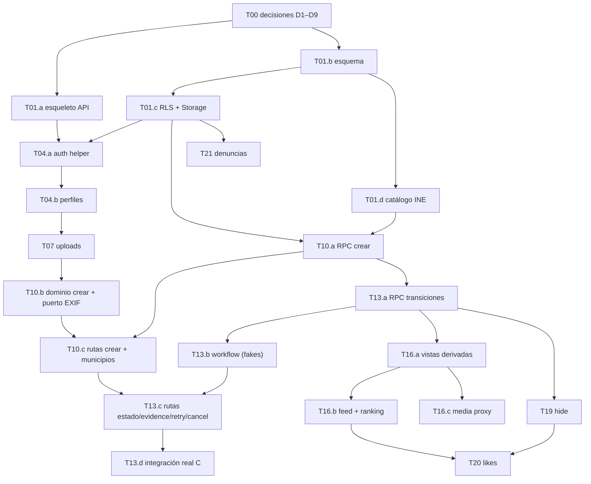

# Plan de subtareas — Dev A (backend, Postgres, contratos)

**Estado:** propuesta del planificador A · **pendiente de aprobación humana** · no hay código escrito.
**Alcance:** solo las tareas A de [`todo.md`](todo.md): T01, T04, T07, T10, T13, T16, T19, T20, T21 (más la parte de A en T00).
**Regla de `todo.md`:** cuando una tarea se divide se usan subtareas `Txx.a/b` con trazabilidad. Este documento **no sustituye** a `todo.md` ni a `plan.md`; el integrador humano decide si refleja aquí las subtareas en ellos.

Fuentes normativas (por orden): `docs/specs/SPEC-{identity,contributions,scoring,community}.md`, `docs/design/{api-contracts,data-model,architecture}.md`, ADR-002/003, `docs/design/release-checklist.md`. Si una subtarea choca con ellas → **parar y escalar**; no reinterpretar.

---

## 0. Hechos verificados del entorno (2026-10-10)

| Herramienta | Estado en la máquina de A |
|---|---|
| Deno | 2.9.7 ✅ (runtime de Edge Functions y runner de tests) |
| Node / npm | 24.20 / 11.19 ✅ (`npx supabase@<versión>` disponible bajo demanda) |
| Docker | ❌ **no instalado** → `supabase start` / `supabase db reset` / `supabase test db` locales **no son posibles** |
| Supabase CLI, psql | ❌ binarios no instalados (el CLI sigue disponible vía `npx supabase@<versión>` si hiciera falta) |
| **Supabase MCP** | ✅ según el usuario, **conectado en Claude Code desde terminal** (OAuth). No visible en la sesión de escritorio del planificador → el agente implementador debe trabajar desde esa terminal. |
| Repositorio | solo documentación; no existen `supabase/`, `tests/`, `package.json` |

**Uso del Supabase MCP por el agente A** (comprobar al empezar con `list_projects`/`get_project_url` qué proyecto está enlazado y qué herramientas expone; los nombres siguientes son los del servidor oficial y deben verificarse):

| Necesidad | Herramienta MCP | Regla |
|---|---|---|
| Aplicar migraciones | `apply_migration` | **El fichero `supabase/migrations/*.sql` del repo es la fuente de verdad**: primero se escribe el fichero, después se aplica **su contenido exacto** con el mismo nombre. Nunca SQL ad hoc que no quede en el repo. |
| Inspección / sembrar datos de test | `execute_sql`, `list_tables`, `list_migrations` | `execute_sql` corre con rol privilegiado (**ignora RLS**): sirve para preparar datos (p. ej. `submitted_at` de hace 59/60 min), **no** para demostrar RLS. |
| Avisos de seguridad | `get_advisors` (security) | Ejecutar tras cada migración de T01.c/T10.a/T13.a/T16.a; reportar avisos de RLS/funciones expuestas. |
| Desplegar la función `api` | `deploy_edge_function` | Solo en el proyecto dev; staging lo despliega el integrador. Evita depender de Docker. |
| Logs | `get_logs` (`edge-function`, `postgres`) | Para depurar; no copiar a reportes datos personales ni tokens. |
| URL y clave anon | `get_project_url`, `get_anon_key` (o equivalente) | Van a `.env.test` local, **no** al repo. La `service_role` la pone el humano a mano. |

**Prohibido con el MCP:** operar sobre el proyecto de staging/beta, borrar proyectos o ramas, `reset`, desactivar RLS o aplicar SQL destructivo sin aprobación humana explícita. Si el MCP está enlazado al proyecto equivocado → **parar y avisar**.

**Consecuencia para la estrategia de pruebas** (decisión del planificador, revisable en T00):

1. **Unitarias (sin infraestructura):** toda la lógica pura de `domain/**` (validación de payloads, catálogo de puntos, huella de idempotencia, cursores, máquina de estados, mapeo de errores) con `deno test`. Se ejecutan siempre.
2. **Integración DB/API:** contra un **proyecto Supabase Free de desarrollo/test** (no el de staging). Migraciones aplicadas con el MCP (`apply_migration`). Tests Deno con `SUPABASE_URL`, `SUPABASE_ANON_KEY`, `SUPABASE_SERVICE_ROLE_KEY` en un `.env.test` **no versionado**. **RLS se demuestra solo con clientes anon/usuario reales desde Deno, nunca con `execute_sql`.** Si faltan variables, el test se marca `ignore` con mensaje explícito y el reporte dice **SKIPPED, no PASS**.
3. Las funciones se prueban importando el `handler(req)` exportado por `index.ts` (sin desplegar) y, a partir de CP4/CP5, contra la función desplegada en el proyecto dev con `deploy_edge_function`.

---

## 1. Decisiones que hay que cerrar en T00 (bloquean subtareas concretas)

Son lagunas o contradicciones encontradas en los documentos. **El agente implementador no debe resolverlas por su cuenta.**

| # | Problema detectado | Propuesta del planificador | Bloquea |
|---|---|---|---|
| D1 | ✅ **DECIDIDA (2026-10-10, Dev A).** No existía endpoint de perfil en `api-contracts.md`. | **Opción A (endpoint):** `POST /profiles` `{alias, adultDeclared:true}` → `201 {userId, alias}`; `GET /profiles/me` → `200 {userId, alias}` / `404 PROFILE_REQUIRED`. Errores: `409 ALIAS_TAKEN`, `409 PROFILE_EXISTS` (segundo POST del mismo usuario, sin idempotencia especial), `422 INVALID_ALIAS`, `422 ADULT_DECLARATION_REQUIRED`, `403 PROFILE_REQUIRED` en cualquier escritura (uploads, contributions, likes) sin perfil. Alias: se aplica `trim`, después `^[A-Za-z0-9_.-]{3,24}$`; se guarda con su capitalización; único sin distinguir mayúsculas (índice ya creado); **no editable** en la beta; sin lista de palabras prohibidas (se usa el canal de denuncias). Cuentas sin perfil: B llama a `GET /profiles/me` tras el login y, si es 404, muestra "completa tu perfil"; no se borran ni aparecen en público. `description` de contribuciones: **1–500 confirmado**. Se documenta en el contrato con la subtarea T04.0. | T04.0, T04.b, B-T05 |
| D2 | **Idempotencia "payload diferente con igual clave"** requiere comparar con el payload original, pero el modelo de datos solo tiene `idempotency_key`. | Añadir columna `idempotency_fingerprint text not null` (SHA-256 del payload canónico de creación). | T10.a |
| D3 | **Rate-limit de denuncias** sin tabla ni columna en el modelo de datos. | Tabla `rate_limits(bucket text, window_start timestamptz, hits int, PK(bucket, window_start))`, clave = `report:` + SHA-256(IP + sal secreta del servidor); máx. 5 denuncias/hora por clave + 3/hora por par (clave, contribución). No se guarda IP en claro. | T21 |
| D4 | **Reutilización de un mismo `photoPath`** en dos contribuciones no está prohibida. | Índice único sobre `contributions.evidence_path`. | T01.b |
| D5 | **Nombres de migración** de `todo.md` (`20261010_schema.sql`, `20261010_security.sql`…) comparten versión `20261010`; la CLI de Supabase usa el prefijo numérico como **versión única** → colisión. | Usar `YYYYMMDDHHMMSS_nombre.sql` (ej. `20261010000100_schema.sql`). Mismo propósito, solo cambia el nombre. | T01.* y siguientes |
| D6 | **Propiedad de archivos no asignada** que A necesita: `supabase/config.toml` (necesario para `verify_jwt=false`: `/feed`, `/media/{id}` y `/reports` son públicos y `` no envía cabecera `Authorization`), `supabase/functions/api/deno.json` y el script de importación INE. | Asignar a A: `supabase/config.toml`, `supabase/functions/api/deno.json`, `supabase/scripts/**`. | T01.a, T01.d |
| D7 | **Interfaces con C** (A las consume, C las implementa). Hay que fijarlas para que A trabaje con *fakes* sin esperar a C. | Firmas propuestas en §4. C confirma o corrige en T00. | T10.b, T13.b, T16.c |
| D8 | **Proyectos Supabase Free:** el plan Free permite 2 proyectos activos. | Proyecto 1 = dev/test (A lo puede resetear); proyecto 2 = staging/beta (solo aplica migraciones el integrador). Claves solo en `.env.test` local / secretos de Supabase. | T01.* integración |
| D9 | **Carga de A:** A es la ruta crítica (9 tareas, ~20 subtareas en ~4 h 30 min). | Si A va retrasado en CP6, el humano puede transferir **explícitamente** T21 (denuncias, solo depende de T01) a otra persona/agente. | Riesgo de plan |

---

## 2. Convenciones técnicas que deben seguir todas las subtareas A

- **Estructura:** `supabase/functions/api/index.ts` (router + `Deno.serve`), `routes/*.ts` (HTTP: parseo, auth, mapeo de errores), `domain/*.ts` (reglas puras, sin I/O salvo a través de puertos inyectados). `index.ts` **exporta** `handler(req: Request): Promise<Response>` para tests.
- **Router:** la función recibe rutas `/api/v1/...` (el prefijo `/functions/v1` lo quita la plataforma — **verificar con SDD**). Usar Hono (patrón de la guía oficial de *routing* de Supabase, citada en `api-contracts.md`) o `URLPattern` nativo; decidirlo en T01.a con SDD y no cambiarlo después.
- **Errores:** siempre `{ error: { code, message, details } }` (api-contracts §1). Un solo helper `httpError(status, code, message, details?)`. Mensajes seguros, sin SQL, rutas privadas, tokens ni emails.
- **Auth:** `requireUser(req)` valida el JWT en servidor y **deriva** `userId`; nunca se lee `userId` del body/query. Endpoints públicos usan `optionalUser(req)`.
- **Base de datos:** la función usa `service_role` **después** de autorizar. Toda regla de unicidad/cooldown/transición vive en funciones SQL (RPC) transaccionales; nada de `SELECT` + `INSERT/UPDATE` separados desde TypeScript.
- **Errores de RPC:** `raise exception using errcode = 'P0001', message = '<ERROR_CODE>', detail = '<json>'`; `domain/http.ts` mapea `message` → código HTTP del catálogo de api-contracts §6.
- **RPC y PostgREST:** las funciones de `public` quedan expuestas por PostgREST → en cada migración `revoke execute on function … from public, anon, authenticated; grant execute … to service_role;`. Tablas: RLS activada, sin políticas de escritura para `anon`/`authenticated`.
- **DTO:** camelCase, enums UPPER_SNAKE, fechas ISO UTC. Fuente única de tipos DTO: `supabase/functions/api/domain/contracts.ts` (B los replica en `src/` y no los cambia sin A).
- **Constantes de negocio:** `RECYCLING=10`, `LITTER_COLLECTION=20`, cooldown 60 min, ventana EXIF 60 min, feed 30 días, `limit` 20 (máx. 50), imagen ≤5 MB JPEG/PNG/WebP. Definidas **una vez** en SQL (fuente de verdad de puntos) y reflejadas en `domain/contracts.ts` solo como información.
- **Tests:** unitarias en `tests/api/*.test.ts` / `tests/db/*.test.ts` con `deno test`; soporte compartido en `tests/db/support.ts`. Comando estándar:
  `deno test --allow-env --allow-net --allow-read --env-file=.env.test --node-modules-dir=none tests/`
  (`--node-modules-dir=none` es obligatorio porque la raíz tiene el `package.json` del front; verificado en T01.b).
  Si aparece `Cannot find module 'tslib'` desde la app de escritorio de Claude (caché de Deno virtualizada), usar un `DENO_DIR` propio; no es un fallo del código.
- **Proyecto DEV para tests:** CAPTCHA de Supabase Auth **desactivado en DEV** (los tests inician sesión con email/contraseña); el CAPTCHA se prueba en staging (T05/T18).

---

## 2b. Flujo de ramas y merge (una rama por subtarea)

Cada subtarea se hace en su propia rama y termina con un merge a `main`. Reglas para A:

1. **Rama desde `main` actualizado:** `git switch main && git pull && git switch -c task/<Txx.y>-<slug>` (ej. `task/T10a-create-rpc`). Nombre siempre con el ID de la subtarea.
2. **No empezar una subtarea hasta que sus dependencias estén fusionadas en `main`.** El agente lo comprueba al inicio (`git log --oneline main` muestra los merges de las dependencias); si falta alguna → `BLOCKED`, sin crear una rama encima de otra rama sin fusionar. Única excepción, decidida por el humano: apilar sobre la rama anterior si el merge se retrasa, y entonces se fusionan en orden.
3. **Una subtarea A abierta a la vez.** Varias subtareas A tocan los mismos archivos (`index.ts` para registrar rutas, `routes/contributions.ts`, `domain/contribution.ts`, `domain/ports.ts`, `routes/community.ts`); en paralelo generarían conflictos. El orden de §3 ya es secuencial. **Excepción:** dos subtareas sin archivos en común y sin dependencia entre ellas pueden ir en paralelo si cada agente trabaja en **su propio `git worktree`** (nunca dos agentes en la misma carpeta). Ejemplo: T04.0 en paralelo con T01.d.
4. **Antes de pedir el merge:** `git fetch && git rebase origin/main` (o merge de `main`), volver a ejecutar los checks de la subtarea y reportarlos **después** del rebase. B y C también fusionan en `main` durante el día.
5. **Merge:** lo hace el integrador humano (A), no el agente, tras revisar el reporte y el diff. Sin `--force` sobre `main`. `main` debe quedar compilable (`deno check supabase/functions/api/index.ts` + tests unitarios en verde).
6. **Migraciones y ramas:**
   - El timestamp de la migración se fija al crearla y es **mayor que el de todas las migraciones que ya hay en `main`**; si tras el rebase quedara desordenado, renombrar antes del merge (solo si aún no se ha aplicado en ningún proyecto compartido).
   - Mientras la rama está abierta, la migración solo se aplica en el **proyecto DEV**. Si la revisión pide cambios en una migración ya aplicada en DEV, **no editar el fichero aplicado**: añadir una migración correctora nueva (o, con permiso humano, rehacer el proyecto DEV).
   - Una migración fusionada en `main` es inmutable. Staging solo recibe migraciones de `main`, aplicadas por el integrador.
7. **Cambios de contrato** (`domain/contracts.ts`, códigos de error, endpoints) van en su propia subtarea/merge, nunca escondidos dentro de otra subtarea. A decide y fusiona; B y C los leen desde `main` (decisión de Dev A, 2026-10-10).
8. **Commits:** mensajes convencionales con el ID (`feat(api): T10.a create_contribution RPC`), sin secretos; `.env.test` debe estar en `.gitignore` (lo añade T01.a si no existe — `.gitignore` se suma a los archivos permitidos de T01.a).

## 3. Grafo de subtareas A



Orden lineal recomendado para un único agente A:
**T01.a → T01.b → T01.c → T01.d → T04.a → T04.b → T07 → T10.a → T10.b → T10.c → T13.a → T13.b → T13.c → T16.a → T16.b → T16.c → T19 → T13.d → T20 → T21**
(T13.d se coloca cuando C haya entregado T06+T09; si llegan antes, adelantarlo justo después de T13.c.)

---

## 4. Interfaces que A consume de C (a confirmar en T00, D7)

A programa contra estas firmas con *fakes* en tests; la integración real se hace en T13.d/T16.c.

```ts
// supabase/functions/api/ai/validator.ts  (C, T06)  — tipos de api-contracts §5
export function validateEvidence(input: ValidationInput): Promise<ValidationResult>;
// Lanza AiTechnicalError ante timeout/403/429/JSON inválido; nunca devuelve APPROVED en fallo.

// supabase/functions/api/media/evidence.ts  (C, T09)
export function inspectEvidence(bytes: Uint8Array, origin: 'GALLERY' | 'CAMERA_FLOW', serverNow: Date):
  { ok: true; mime: 'image/jpeg' | 'image/png' | 'image/webp'; captureExifAt: Date | null }
  | { ok: false; code: 'EXIF_REQUIRED' | 'PHOTO_TOO_OLD' | 'UNSUPPORTED_MEDIA' };

// supabase/functions/api/media/sanitize.ts  (C, T09)
export function sanitizeForPublication(bytes: Uint8Array): Promise<{ bytes: Uint8Array; contentType: string }>;
// Lanza si no puede re-codificar: A NO aprueba en ese caso.
```

En A, estas dependencias entran por un objeto `ports` inyectado (`domain/ports.ts`), para poder sustituirlas por fakes en tests.

---

## 5. Subtareas

Formato por subtarea: objetivo · dependencias · archivos (≤5) · criterios · verificación · skills · fuera de alcance.

### Fase CP1 — Fundaciones (objetivo 00:15–00:45)

#### T01.a — Esqueleto de la Edge Function `api` y helpers HTTP
- **Depende de:** T00 (D5, D6 cerrados).
- **Archivos:** `supabase/config.toml`, `supabase/functions/api/deno.json`, `supabase/functions/api/index.ts`, `supabase/functions/api/domain/http.ts`, `supabase/functions/api/domain/contracts.ts`.
  Test: `tests/api/http.test.ts`. Además `.gitignore` (solo para añadir `.env*` salvo `.env.example`). Supera el límite de 5 archivos de código → si el revisor lo exige, mover `contracts.ts` a una subtarea T01.a2.
- **Descripción:** router con prefijo `/api/v1`, CORS limitado a orígenes de una variable `ALLOWED_ORIGINS`, respuesta `OPTIONS`, 404 JSON para rutas desconocidas, helper de errores, tipos DTO y enums de api-contracts §4–§6. `verify_jwt = false` para `api` (la autorización la hace la función por ruta).
- **Criterios:**
  - [ ] `handler(new Request('…/api/v1/desconocido'))` → `404 {error:{code:'NOT_FOUND'}}`; preflight con origen permitido → cabeceras CORS; origen no permitido → sin `Access-Control-Allow-Origin`.
  - [ ] `contracts.ts` contiene exactamente los DTO/enum/códigos de error de api-contracts (más los de D1 si se aprueban), sin campos inventados.
  - [ ] Ninguna excepción no controlada devuelve stack/mensaje interno (`500 INTERNAL`).
- **Verificación:** `deno test tests/api/http.test.ts`; `deno check supabase/functions/api/index.ts`.
- **Skills:** incremental-implementation, **source-driven-development** (routing de Supabase, `verify_jwt` en `config.toml`, Hono vs `URLPattern`).
- **Fuera de alcance:** ningún endpoint de negocio; ningún endpoint de "health" (no está en el contrato).

#### T01.b — Migración de esquema e invariantes
- **Depende de:** T00 (D2, D4, D5).
- **Archivos:** `supabase/migrations/20261010000100_schema.sql`, `tests/db/support.ts`, `tests/db/schema.test.ts`.
- **Descripción:** tablas `profiles`, `municipalities`, `contributions`, `likes`, `reports` según data-model §1–§2. Tipos/`check` para `action_type`, `status`, `capture_origin`; `points_snapshot` con `check` coherente con el tipo (10/20); `description` con `check (length(trim(description)) between 1 and 500)` (límite propuesto: confirmar); índice único `lower(alias)` (DB-01); índice único parcial pendiente (DB-03); único `(author_id, idempotency_key)` (DB-05); `idempotency_fingerprint` (D2); único `evidence_path` (D4); PK compuesta de `likes` y `check` de no auto-like **no** (requiere join; va en RPC T20); `validation_version int not null default 0`; `processing_lease_until`. Trigger que impide modificar `submitted_at`, `points_snapshot`, `author_id` tras insertar.
  `tests/db/support.ts`: carga env, crea clientes anon/service, crea usuarios de prueba con la API admin y los borra al final.
- **Criterios:**
  - [ ] La migración se aplica limpia en el proyecto dev (`apply_migration`) y es re-aplicable en un proyecto vacío.
  - [ ] Insertar un segundo pendiente del mismo `(author, type)` falla por el índice parcial; alias `Eco`/`eco` duplicado falla; `update` de `submitted_at` falla.
  - [ ] `points_snapshot` 15 para `RECYCLING` es rechazado por `check`.
- **Verificación:** resultado real de `apply_migration` (MCP) + `list_migrations`; `deno test tests/db/schema.test.ts` (o SKIPPED explícito si no hay env).
- **Skills:** incremental-implementation, **test-driven-development** (escribir primero los tests de restricción).
- **Seguridad mínima ya en T01.b:** cada tabla se crea con `enable row level security` (sin políticas = todo denegado), porque en Supabase las tablas nuevas de `public` quedan expuestas por PostgREST a `anon`/`authenticated` en cuanto existen. T01.c añade revokes, políticas y buckets.
- **Fuera de alcance:** políticas RLS, revokes, buckets, RPC, vistas.

#### T01.c — RLS por defecto denegada, grants y buckets privados
- **Depende de:** T01.b.
- **Archivos:** `supabase/migrations/20261010000200_security.sql`, `tests/db/rls.test.ts`.
- **Descripción:** `enable row level security` en las 5 tablas (+ `rate_limits` si D3 se aprueba, o en T21). `revoke all` a `anon`/`authenticated` sobre tablas; única política de lectura: `profiles` propio (`auth.uid() = user_id`). `municipalities` legible por anon **solo** si se decide servirla directo; por contrato va por `/municipalities` → sin política. Buckets `evidence-private` y `published-private` con `public = false`, `file_size_limit = 5 MB`, `allowed_mime_types` JPEG/PNG/WebP; **ninguna** política de lectura en `storage.objects` para anon/authenticated.
- **Criterios:**
  - [ ] Con cliente anon y con cliente de usuario B: `select`/`insert`/`update` sobre `contributions`, `likes`, `reports` y `profiles` ajeno devuelven 0 filas o error; el perfil propio sí se lee.
  - [ ] Descargar un objeto de `evidence-private` sin token o con JWT de otro usuario falla; los buckets no son públicos.
  - [ ] `service_role` sí lee/escribe (sanity check del backend).
- **Añadido tras T01.b:** `revoke execute` de `public.rls_auto_enable()` (función del event trigger `ensure_rls` creado por la opción de RLS automática de Supabase) para `public, anon, authenticated`, dentro de un bloque que comprueba si existe (en staging puede no existir). No borrar la función ni el event trigger. Valorar `alter default privileges … revoke execute on functions … from public, anon, authenticated` (verificar con SDD).
- **Índices de FK pendientes (aviso de T01.b):** `likes(contribution_id)` va en T20 y `reports(contribution_id)` en T21; `contributions(municipality_code)` no se añade (no hay consultas por municipio en la beta).
- **Verificación:** `apply_migration` (MCP) + `get_advisors` security sin avisos de RLS + `deno test tests/db/rls.test.ts` con dos usuarios reales del proyecto dev y anónimo.
- **Skills:** **TDD** (pruebas de denegación primero), **SDD** (Storage access control, `storage.buckets` columnas `file_size_limit`/`allowed_mime_types`, si la subida por *signed upload URL* respeta los límites del bucket).
- **Fuera de alcance:** RPC de negocio.

#### T01.d — Catálogo oficial de municipios INE (**acotado a la provincia de Barcelona**)
- **Cambio de alcance (2026-10-10, decisión de Dev A por tiempo):** la beta solo carga los municipios de la **provincia de Barcelona (CPRO = 08), 311 según el diccionario INE 2026**. Es una *adaptación para la beta* de RQ-75/RQ-77 y CON-02 (catálogo de toda España), no una derogación: el script sigue siendo genérico y ampliar a otras provincias es regenerar con otro filtro.
- **Depende de:** T01.b, D6. Fuente ya descargada: `https://www.ine.es/daco/daco42/codmun/diccionario26.xlsx` (sha256 en la cabecera de la migración), provincias: `https://www.ine.es/daco/daco42/codmun/cod_provincia.htm`.
- **Archivos:** `supabase/scripts/ine-to-sql.ts` (con filtro de provincia), `supabase/migrations/20261010000300_municipalities_ine_barcelona.sql` (generado, **una sola migración**), `tests/db/municipalities.test.ts`, y la nota de adaptación en `docs/specs/SPEC-contributions.md`, `docs/specs/capability-map.md`, `docs/design/data-model.md` y `docs/design/api-contracts.md`.
- **Estado de DEV:** las migraciones remotas `municipalities_ine_1..3` + `municipalities_barcelona_only` ya dejaron exactamente las 311 filas de la provincia 08. En el repo se sustituyen por la migración única `…000300`, que **no se vuelve a aplicar en DEV**: se comprueba que su contenido coincide con DEV y se anota la correspondencia (1 fichero ↔ 4 versiones remotas). Staging aplicará solo la migración única.
- **Criterios:**
  - [ ] DEV y la migración tienen 311 filas, todas con código `08___`; el script imprime 8132 leídas / 311 escritas.
  - [ ] `08019` → Barcelona / Barcelona existe; `28079` (Madrid) **no** existe; `99999` no existe; anon no lee la tabla directamente.
  - [ ] Las 4 migraciones provisionales no llegan al repo; los documentos normativos indican la adaptación.
- **Verificación:** salida real del script + comparación DEV ↔ fichero (conteo y huella de las filas ordenadas) + `deno test … tests/`.
- **Impacto en otras tareas:** T10.c (`/municipalities` solo devuelve la provincia 08; otro código → `422 INVALID_MUNICIPALITY`), B-T08 (el selector debe indicar "solo provincia de Barcelona en la beta"), textos públicos de T22/T23.

> **Checkpoint CP1 (A):** T01.a–d aplicados en el proyecto dev; compartir con B/C `contracts.ts`, nombres de buckets y la lista de códigos de error. Informar SKIPPED/PASS reales.

### Fase CP2 — Identidad (objetivo 00:45–01:25)

#### T04.0 — Cambio de contrato: perfiles (D1)
- **Depende de:** D1 (decidida). Va **antes** de T04.b y debe fusionarse pronto para que B lo use en T05.
- **Archivos:** `docs/design/api-contracts.md`, `supabase/functions/api/domain/contracts.ts`.
- **Descripción:** añadir a api-contracts §3 las filas `POST /profiles` y `GET /profiles/me`; a §4 sus payloads; a §6 los códigos `ALIAS_TAKEN`, `PROFILE_EXISTS`, `INVALID_ALIAS`, `ADULT_DECLARATION_REQUIRED`, `PROFILE_REQUIRED` y el genérico `400 INVALID_REQUEST` (cuerpo malformado, ya previsto en §1 sin código); los códigos que necesiten T07/T10/T21 (p. ej. `PHOTO_NOT_FOUND`, `UNSUPPORTED_MEDIA`, `RATE_LIMITED`) se añaden en esas subtareas; en §2 sustituir "el servidor finaliza la creación de `profiles`" por el flujo concreto (signUp → `POST /profiles` con sesión; `GET /profiles/me` tras login) y las reglas del alias; en §4 (crear contribución) indicar `description` 1–500 caracteres tras `trim`. Reflejar lo mismo en `contracts.ts` (tipos `CreateProfileRequest`, `ProfileDto`, códigos). Nada más del contrato cambia.
- **Criterios:**
  - [ ] El contrato y `contracts.ts` coinciden exactamente con D1 (§1 de este plan).
  - [x] ~~B revisa el diff antes del merge~~ → Dev A decide (2026-10-10): A fija el contrato y B lo consume desde `main`; no se espera revisión de B. Fusionada en `3045a51`.
- **Verificación:** `deno check supabase/functions/api/index.ts`; tests de A sin regresiones.
- **Skills:** incremental-implementation.

#### T04.a — Autenticación de servidor (`requireUser` / `optionalUser` / `requireProfile`)
- **Depende de:** T01.a, T01.c.
- **Archivos:** `supabase/functions/api/domain/auth.ts`, `supabase/functions/api/domain/db.ts` (factoría del cliente service-role desde secretos), `tests/api/auth.test.ts`.
- **Descripción:** extraer `Bearer`, validar el JWT en servidor y devolver `{ userId }`; `optionalUser` para lecturas públicas; `requireProfile` comprueba fila en `profiles` (D1).
- **Criterios:**
  - [ ] Sin cabecera → `401 AUTH_REQUIRED`; token mal formado/caducado/firmado por otro proyecto → `401`; token válido → `userId` del claim `sub`, nunca de body/query.
  - [ ] `SUPABASE_SERVICE_ROLE_KEY` solo se lee de `Deno.env`; no aparece en ninguna respuesta ni log.
- **Verificación:** `deno test tests/api/auth.test.ts` (unitario con verificador falso + integración con usuario real del proyecto dev).
- **Skills:** **TDD**, **SDD** (`auth.getUser(jwt)` vs `auth.getClaims()`/JWKS en la versión actual de supabase-js; elegir una y citar la doc).

#### T04.b — `POST /profiles` y `GET /profiles/me`
- **Depende de:** T04.a, T04.0 fusionada.
- **Archivos:** `supabase/functions/api/routes/profiles.ts`, `supabase/functions/api/domain/profile.ts`, `supabase/functions/api/index.ts` (registro de ruta), `tests/api/profiles.test.ts`.
- **Descripción:** validar alias (formato D1) y `adultDeclared === true`; insertar con `user_id` del JWT y `adult_declared_at = now()`; violación de único → `409 ALIAS_TAKEN`; perfil ya existente del mismo usuario → `409 PROFILE_EXISTS`; body no JSON o campos de tipo incorrecto → `400 INVALID_REQUEST`.
- **Criterios:**
  - [ ] Dos usuarios: el segundo con el mismo alias (otra capitalización) recibe `409 ALIAS_TAKEN`.
  - [ ] `adultDeclared` ausente/false → `422`; sin JWT → `401`; un `userId` en el body se ignora.
  - [ ] La respuesta nunca contiene email.
- **Verificación:** `deno test tests/api/profiles.test.ts` con dos usuarios reales + anónimo.
- **Skills:** **TDD**.

#### T04.c — Revocación de sesión y despliegue en DEV (añadida tras T04.b)
- **Motivo:** en T04.b, un access token conservado tras `signOut({ scope: 'global' })` siguió dando `200` en `GET /profiles/me`, porque `getClaims` valida la firma en local sin consultar la sesión. Eso incumple SPEC-identity ID-04. Además, la función `api` no llegó a desplegarse en DEV.
- **Decisión del planificador:** el verificador real pasa a `auth.getUser(token)`, que consulta el servidor de Auth. Se usa uno solo para escrituras y lecturas; el coste es una llamada a Auth por petición autenticada, aceptable en la beta.
- **Archivos:** `supabase/functions/api/domain/auth.ts`, `tests/api/auth.test.ts`, `tests/api/profiles.test.ts`.
- **Criterios:**
  - [ ] Un token conservado tras un logout global → `401 AUTH_REQUIRED` (el test informativo pasa a ser obligatorio).
  - [ ] La función `api` queda desplegada en DEV con `verify_jwt=false` y `ALLOWED_ORIGINS`; el smoke contra la URL real (OPTIONS, 401 sin token, 404/200 con token) pasa.
- **Skills:** TDD, SDD (`getUser` y sesiones revocadas; despliegue por MCP).

#### T07 — `POST /uploads`: token de subida privada
- **Depende de:** T04.b.
- **Archivos:** `supabase/functions/api/domain/uploads.ts`, `supabase/functions/api/routes/uploads.ts`, `supabase/functions/api/index.ts`, `tests/api/uploads.test.ts`.
- **Descripción:** validar `contentType ∈ {image/jpeg, image/png, image/webp}` y `0 < sizeBytes ≤ 5 MB` (`413`/`422`), generar `photoPath = staging/<userId>/<uuid>` en `evidence-private` y emitir *signed upload URL/token* → `201 {photoPath, uploadToken, expiresAt}`. La validación real de bytes/MIME/EXIF ocurre en T10 sobre el archivo subido.
- **Criterios:**
  - [ ] Solo usuario con perfil; la ruta siempre contiene el `userId` del JWT.
  - [ ] Con el token, el usuario sube su archivo; un archivo >5 MB o de MIME no permitido es rechazado por el bucket; sin token no se puede subir ni leer.
  - [ ] `expiresAt` refleja la caducidad real del token (documentar la duración que impone Supabase).
- **Verificación:** `deno test tests/api/uploads.test.ts` (subida propia OK, tamaño excedido, MIME falso, descarga anónima denegada).
- **Skills:** **SDD** (`createSignedUploadUrl` / `uploadToSignedUrl`, duración del token), **TDD** para `domain/uploads.ts`.

> **Checkpoint CP2/CP3 (A):** B puede registrar perfil y obtener token de subida contra el proyecto dev.

### Fase CP4 — Crear contribución (objetivo 01:50–02:55)

#### T10.a — RPC `create_contribution` transaccional
- **Depende de:** T01.c, T01.d, D2.
- **Archivos:** `supabase/migrations/20261010000400_contribution_create_rpc.sql`, `tests/db/contribution-create-rpc.test.ts`.
- **Descripción:** función SQL que, en una transacción: (1) toma `pg_advisory_xact_lock` sobre `(author_id, action_type)`; (2) si existe fila con `(author_id, idempotency_key)` → misma huella: devuelve la existente; huella distinta: `IDEMPOTENCY_CONFLICT`; (3) valida municipio (`INVALID_MUNICIPALITY`); (4) pendiente existente (`PENDING_CONTRIBUTION_EXISTS`); (5) cooldown: última `APPROVED` (oculta incluida) del par con `submitted_at > now() - 60 min` → `COOLDOWN_ACTIVE` con `retryAt`; (6) inserta `PENDING` con `submitted_at = now()`, `points_snapshot` por tipo, `validation_version = 1`, `processing_lease_until = now() + lease`. Devuelve `{id, status, submittedAt, pointsIfApproved, validationVersion, created:boolean}`. `execute` solo para `service_role`.
- **Criterios:**
  - [ ] Dos llamadas concurrentes del mismo par → una crea, la otra `PENDING_CONTRIBUTION_EXISTS` (o mismo ID si comparten clave y huella).
  - [ ] Cooldown: aprobada hace 59 min → bloquea; hace 60 min → permite; aprobada **y oculta** hace 30 min → bloquea; rechazada/cancelada hace 5 min → permite; otro tipo → permite; otro municipio → bloquea igual.
  - [ ] Misma clave + payload distinto → `IDEMPOTENCY_CONFLICT`; `points_snapshot` no se puede pasar desde fuera.
- **Verificación:** `deno test tests/db/contribution-create-rpc.test.ts` (fijar `submitted_at` de filas sembradas con service role para simular 59/60 min; concurrencia con `Promise.all`).
- **Skills:** **TDD** (obligatorio: regla de negocio y regresión), **SDD** (advisory locks, `raise … using detail`).

#### T10.b — Dominio de creación + puerto EXIF
- **Depende de:** T07, interfaz D7 (puede usar fake de `inspectEvidence`).
- **Archivos:** `supabase/functions/api/domain/contribution.ts`, `supabase/functions/api/domain/ports.ts`, `tests/api/contribution-domain.test.ts`.
- **Descripción:** validar body (enum `actionType`, `description` 1–500 tras `trim`, `municipalityCode` `^\d{5}$`, `captureOrigin` enum, `photoPath` que empiece por `staging/<userId>/`), validar `Idempotency-Key` UUID (`400` si falta), calcular huella canónica SHA-256, descargar el archivo privado (puerto storage) y llamar a `inspectEvidence(bytes, origin, serverNow)` → mapear `EXIF_REQUIRED`/`PHOTO_TOO_OLD` (`422`), `UNSUPPORTED_MEDIA` (`422`), archivo inexistente (`422 PHOTO_NOT_FOUND`, código a añadir en D1/T00).
- **Criterios:**
  - [ ] `photoPath` de otro usuario → `403 NOT_OWNER`; sin clave → `400`; payload inválido → `400`/`422` con `details` del campo.
  - [ ] Con fake de EXIF: GALLERY sin EXIF → `EXIF_REQUIRED`; EXIF 61 min → `PHOTO_TOO_OLD`; la hora usada es la del servidor, nunca un campo del cliente.
  - [ ] La huella no depende del orden de las claves JSON.
- **Verificación:** `deno test tests/api/contribution-domain.test.ts` (unitario puro, sin red).
- **Skills:** **TDD**.

#### T10.c1 — `GET /municipalities?q=` (dividida tras T10.b)
- **Archivos:** `docs/design/api-contracts.md` + `domain/contracts.ts` (DTO), `routes/municipalities.ts`, `index.ts`, `tests/api/municipalities.test.ts`.
- **Contrato (decidido por A, alineado con el cliente de B):** `200 { items: [{ code, name, provinceName }], nextCursor: null }`; `q` ≥ 2 caracteres tras `trim` (si no, `400 INVALID_REQUEST {field:'q'}`); `limit` 1–50, por defecto 20; búsqueda sin distinguir mayúsculas ni acentos; orden por nombre; pública. El catálogo (311 filas) se carga una vez en memoria por instancia.
- **Criterios:** `q=barc` incluye `08019`; `q=valles` encuentra municipios con "Vallès"; `q=b` → 400; sin JWT → 200; nunca devuelve más de `limit`.

#### T10.c2 — `POST /contributions`
- **Archivos:** `routes/contributions.ts`, `index.ts`, `tests/api/contribution-create.test.ts`.
- **Flujo:** `requireUser` → `requireProfile` → `parseIdempotencyKey` → `parseCreateContribution` → `fingerprint` → **si ya existe (autor, clave) con la misma huella, `202` con esa fila sin volver a inspeccionar la foto** (si la huella es distinta → `409 IDEMPOTENCY_CONFLICT`) → `prepareEvidence` (hora del servidor) → RPC `create_contribution` → `202`. Errores de la RPC con `mapCreateRpcError`.
- **Inspector EXIF en producción:** hasta que C entregue `media/evidence.ts` (T09), el `index.ts` de producción usa un inspector que **falla cerrado** (lanza error → `500`); nunca uno que acepte todo. Los tests inyectan uno falso. El cableado real va en T13.d (o antes si C entrega).
- **Criterios:** reintento idéntico → mismo `id`; `NOT_OWNER`, `PHOTO_NOT_FOUND`, `PHOTO_ALREADY_USED`, `PENDING_CONTRIBUTION_EXISTS`, `COOLDOWN_ACTIVE` con `retryAt`, `INVALID_MUNICIPALITY`, `401`, `403 PROFILE_REQUIRED`; el handler de producción sin inspector real no crea nada.

> **Checkpoint CP4 (A):** `PENDING` persistido y único, cooldown 59/60, idempotencia y municipios reales. B ya puede enviar contra el backend real.

### Fase CP5 — Validación, estados y aprobación (objetivo 02:35–03:40)

#### T13.a — RPC de transiciones con versión y reserva
- **Depende de:** T10.a.
- **Archivos:** `supabase/migrations/20261010000500_validation_rpc.sql`, `tests/db/validation-rpc.test.ts`.
- **Descripción:** funciones SQL condicionales (todas `service_role` only):
  - `complete_validation(id, version, decision, reason, public_photo_path)` → solo si `status='PENDING' AND validation_version=version AND processing_lease_until > now()`; `APPROVED` exige `public_photo_path` no nulo y fija `approved_at=now()`; devuelve si aplicó.
  - `mark_technical_error(id, version)` con la misma guarda.
  - `cancel_contribution(id, author)` desde `PENDING|NEEDS_EVIDENCE|TECHNICAL_ERROR` → `CANCELLED`; repetido sobre `CANCELLED` → idempotente; otro estado → `INVALID_STATE`; otro autor → `NOT_OWNER`/404.
  - `retry_validation(id, author)` desde `TECHNICAL_ERROR` o `PENDING` con reserva vencida → `PENDING`, `version+1`, nueva reserva.
  - `submit_evidence(id, author, path, origin, exif_at)` desde `NEEDS_EVIDENCE` → `PENDING`, nueva ruta, `version+1`, nueva reserva; **`submitted_at` no cambia**.
- **Criterios:**
  - [ ] Doble `complete_validation(APPROVED)` con la misma versión → la segunda no aplica; puntos derivados = una vez.
  - [ ] Cancelar y después completar con la versión anterior → sigue `CANCELLED`; resultado con versión antigua tras un `retry` → descartado; reserva vencida → descartado.
  - [ ] `CANCELLED`/`REJECTED` → `APPROVED` imposible; `APPROVED` sin `public_photo_path` imposible.
- **Verificación:** `deno test tests/db/validation-rpc.test.ts` (incluye carreras con `Promise.all`).
- **Skills:** **TDD** (obligatorio).

#### T13.b — Orquestador `validation-workflow` con puertos
- **Depende de:** T13.a, interfaces D7 (con fakes).
- **Archivos:** `supabase/functions/api/domain/validation-workflow.ts`, `supabase/functions/api/domain/ports.ts` (ampliación), `tests/api/validation-workflow.test.ts`.
- **Descripción:** `runValidation(id, version, ports)`: lee la contribución y la imagen privada → `validateEvidence` → si `APPROVED`: `sanitizeForPublication` → sube la copia a `published-private/<id>` → `complete_validation(APPROVED, path)`; si `NEEDS_EVIDENCE`/`REJECTED`: `complete_validation` sin foto; cualquier excepción de IA, sanitizado o Storage → `mark_technical_error`. Guarda solo `reason` saneado (longitud máx., sin HTML), nunca la respuesta cruda ni bytes en logs.
- **Criterios:**
  - [ ] Fake IA lanza timeout/429/JSON inválido → `TECHNICAL_ERROR`, 0 puntos, nada en `published-private`.
  - [ ] Fake sanitizado lanza → **no** `APPROVED` (queda `TECHNICAL_ERROR`).
  - [ ] Si `complete_validation` no aplica (cancelada/versión antigua), se borra la copia publicada recién subida y no hay error visible.
- **Verificación:** `deno test tests/api/validation-workflow.test.ts` (unitario, puertos falsos, sin red).
- **Skills:** **TDD**.

#### T13.c — Rutas `GET /contributions/{id}`, `evidence`, `retry`, `cancel` + disparo en segundo plano
- **Depende de:** T13.b, T10.c.
- **Archivos:** `supabase/functions/api/routes/contributions.ts`, `supabase/functions/api/domain/contribution.ts` (mapeo a DTO y flags `canRetry/canProvideEvidence/canCancel`), `tests/api/approval.test.ts`.
- **Descripción:** `GET` solo autor (ajeno → `404`), `effectivePoints = points_snapshot` solo si `APPROVED` y no oculta. `create`, `evidence` y `retry` lanzan `EdgeRuntime.waitUntil(runValidation(id, version))` tras el `202`. `evidence` reutiliza la validación de T10.b (propiedad de ruta + EXIF).
- **Criterios:**
  - [ ] El DTO coincide con api-contracts §4 (sin `evidence_path`, sin versión ni lease).
  - [ ] `cancel`/`retry`/`evidence` en estado no permitido → `409 INVALID_STATE`; usuario ajeno → `404`.
  - [ ] Con puertos falsos: crear → `PENDING` → (worker) `APPROVED`, `effectivePoints` 10/20; cancelar antes de que termine el worker → queda `CANCELLED`.
- **Verificación:** `deno test tests/api/approval.test.ts` contra proyecto dev con puertos falsos.
- **Skills:** **SDD** (`EdgeRuntime.waitUntil`, límites de duración del plan Free), **TDD**.

#### T13.d — Integración con los módulos reales de C
- **Depende de:** T13.c + C-T06 y C-T09 fusionados.
- **Archivos:** `supabase/functions/api/domain/ports.ts` (cableado real), `tests/api/approval.test.ts` (caso real marcado, opcional por env).
- **Descripción:** sustituir fakes por `validateEvidence`, `inspectEvidence`, `sanitizeForPublication` reales en el `handler` de producción; los fakes **solo** en tests. Probar en staging una aprobación real con **imagen propia del equipo** (nunca de ciudadanos) cuando C haya cerrado el gate T02.
- **Criterios:**
  - [ ] El bundle de producción no importa ningún fake (comprobación con `grep`/`deno info`).
  - [ ] Una contribución real en staging llega a `APPROVED` con copia en `published-private` sin EXIF (C lo verifica) o a `TECHNICAL_ERROR` con motivo; nunca aprobado por error.
- **Verificación:** test real ejecutado + ID de la contribución y commit; resultado tal cual (también si es BLOCKED por C).
- **Skills:** incremental-implementation.

> **Checkpoint CP5 (A+C):** un flujo real aprobado/publicado/puntuado en staging; si no, BLOCKED con causa.

### Fase CP6 — Lecturas públicas (objetivo 03:15–04:15)

#### T16.a — Vistas/funciones derivadas: visibilidad, puntos, ranking y feed
- **Depende de:** T13.a.
- **Archivos:** `supabase/migrations/20261010000600_public_reads.sql`, `tests/db/public-reads-sql.test.ts`.
- **Descripción:** `visible_contributions` (data-model §4); `get_leaderboard(limit, offset)` con `rank()` sobre suma de `points_snapshot` (empate = mismo `rank`, orden estable por alias); `get_feed(limit, offset, viewer uuid null)` con ventana 30 días desde `approved_at`, orden `like_count desc, approved_at desc, id desc`, `likedByMe`. Sin email ni rutas; `execute` solo `service_role`.
- **Criterios:**
  - [ ] 2 usuarios / 3 contribuciones: puntos 30 y 30 → ambos `rank 1`; oculta o pendiente no suma ni aparece.
  - [ ] Aprobada hace 31 días no aparece en el feed pero sí suma en ranking.
  - [ ] Los likes cambian el orden del feed y **no** el ranking.
- **Verificación:** `deno test tests/db/public-reads-sql.test.ts`.
- **Skills:** **TDD**.

#### T16.b — Rutas `GET /feed` y `GET /leaderboard`
- **Depende de:** T16.a.
- **Archivos:** `supabase/functions/api/routes/public-reads.ts`, `supabase/functions/api/domain/public-queries.ts` (cursor opaco base64 de offset, `limit` 1–50, mapeo DTO), `supabase/functions/api/index.ts`, `tests/api/public-reads.test.ts`.
- **Descripción:** endpoints públicos con `optionalUser` (para `likedByMe`), `imageUrl = /v1/media/<id>` relativo a la API, `nextCursor` nulo al terminar.
- **Criterios:**
  - [ ] Sin JWT → `200`; respuesta sin email, `evidence_path`, `public_photo_path` ni campos internos (test que busca esas claves en el JSON).
  - [ ] `limit=51` → `422` o recorte a 50 (decidir y documentar); cursor manipulado → `400`.
  - [ ] Paginación sin duplicados con datos estables.
- **Verificación:** `deno test tests/api/public-reads.test.ts`.
- **Skills:** **TDD**.

#### T16.c — `GET /media/{id}` (proxy de copia saneada)
- **Depende de:** T16.a; helper de C si se acuerda (D7), si no, lectura directa de `published-private`.
- **Archivos:** `supabase/functions/api/routes/media.ts`, `supabase/functions/api/index.ts`, `tests/api/media.test.ts`.
- **Descripción:** comprobar visibilidad **en cada petición**; servir bytes de `published-private/<id>` con `Content-Type` correcto y `Cache-Control: no-store`; cualquier otro caso → `404` (no distinguir "oculta" de "inexistente"). Nunca leer `evidence-private`.
- **Criterios:**
  - [ ] Aprobada visible → `200` + `no-store`; pendiente/rechazada/oculta/inexistente → `404`.
  - [ ] Tras `hide` (T19) la misma URL pasa a `404`.
- **Verificación:** `deno test tests/api/media.test.ts`.
- **Skills:** **TDD**.

### Fase CP7 — Comunidad y retirada (objetivo 03:40–04:30)

#### T19 — `POST /contributions/{id}/hide` con revocación
- **Depende de:** T13.a, T16.a.
- **Archivos:** `supabase/migrations/20261010000700_hide_rpc.sql`, `supabase/functions/api/routes/contributions.ts`, `tests/api/hide.test.ts`.
- **Descripción:** RPC `hide_contribution(id, author)`: solo `APPROVED` y autor; fija `hidden_at` una vez; repetida → éxito idempotente sin cambios; no toca `submitted_at` ni `points_snapshot` (el cooldown se mantiene). Opcional: borrar la copia de `published-private` (no hace falta para revocar; la visibilidad ya la bloquea).
- **Criterios:**
  - [ ] Tras ocultar: desaparece del feed, `/media/{id}` → `404`, ranking baja exactamente 10/20; repetir no vuelve a bajar.
  - [ ] Usuario ajeno → `404`/`403 NOT_OWNER`; `PENDING` → `409 INVALID_STATE`.
  - [ ] Nueva contribución del mismo tipo dentro de los 60 min tras ocultar → `COOLDOWN_ACTIVE`.
- **Verificación:** `deno test tests/api/hide.test.ts` con dos usuarios.
- **Skills:** **TDD**.

#### T20 — `PUT/DELETE /contributions/{id}/like`
- **Depende de:** T16.b, T19.
- **Archivos:** `supabase/migrations/20261010000800_likes_rpc.sql`, `supabase/functions/api/routes/community.ts`, `supabase/functions/api/index.ts`, `tests/api/likes.test.ts`.
- **Descripción:** RPC `set_like(user, id, liked bool)`: publicación visible y autor ≠ usuario; `insert … on conflict do nothing` / `delete`; ambos idempotentes. Respuesta `200 {liked, likeCount}` (o `204`; fijarlo en el contrato si no lo está — **no está especificado en api-contracts**, confirmar con B).
- **Criterios:**
  - [ ] Like propio → `403`; publicación oculta/pendiente → `404`; sin JWT → `401`.
  - [ ] Like doble → un solo registro; quitar y volver a poner funciona; el ranking no cambia en ningún caso.
- **Verificación:** `deno test tests/api/likes.test.ts`.
- **Skills:** **TDD**.

#### T21 — `POST /reports` anónimo con Turnstile y rate-limit
- **Depende de:** T01.c, D3. (Candidata a transferirse si A va retrasado, D9.)
- **Archivos:** `supabase/migrations/20261010000900_reports_rpc.sql` (tabla `rate_limits` si D3 se aprueba + RPC `submit_report`), `supabase/functions/api/domain/turnstile.ts`, `supabase/functions/api/routes/community.ts`, `tests/api/reports.test.ts`.
- **Descripción:** verificar `turnstileToken` en servidor (siteverify con `TURNSTILE_SECRET_KEY` de secretos) **antes** de tocar la DB; `reason` 1–500; contribución visible (si no, `202` igualmente para no revelar existencia — decidir); aplicar límite D3 (`429 RATE_LIMITED`); insertar en `reports` → `202 {accepted:true}`. Añadir en este documento (sección operador) la consulta SQL para listar denuncias pendientes y para ocultar manualmente una contribución desde la consola.
- **Criterios:**
  - [ ] Sin token / token inválido → `400`/`403` sin insertar; token válido → fila privada, ilegible para anon y usuarios.
  - [ ] Superar el límite → `429`; la respuesta no revela datos del denunciado ni de la persona denunciante.
  - [ ] El procedimiento manual del operador (listar + ocultar) se ensaya una vez en el proyecto dev.
- **Verificación:** `deno test tests/api/reports.test.ts` usando las **claves de prueba oficiales de Turnstile** (siempre pasa / siempre falla) — verificar con SDD; ensayo manual del operador documentado.
- **Skills:** **SDD** (siteverify, claves de prueba de Turnstile), **TDD**.

> **Checkpoint CP7 (A):** hide revoca puntos, like sin puntos, denuncias protegidas y atendibles. Después: solo arreglar bloqueantes y dar soporte a T18/T23 de C.

---

## 6. Plantilla de encargo para el agente implementador

Copiar una por subtarea, rellenando `<…>`:

```text
Eres el Agente A (implementador). Ejecuta SOLO la subtarea <Txx.y> de docs/tasks/dev-a-subtasks.md.
Lee antes: AGENTS.md, docs/tasks/dev-a-subtasks.md (§0, §2, §4 y tu subtarea), docs/design/api-contracts.md,
docs/design/data-model.md y la SPEC indicada en la trazabilidad de la tarea original en docs/tasks/todo.md.
Lee y sigue las skills del repo en .claude/skills/<nombre>/SKILL.md antes de empezar.
Skills: $incremental-implementation; $test-driven-development <si la subtarea lo indica>; $source-driven-development <para los puntos marcados SDD>.
Ramas (§2b): actualiza main y crea task/<Txx.y>-<slug> desde main. Comprueba que las dependencias de la subtarea ya están fusionadas en main; si no, STATUS=BLOCKED y no empieces. Antes de reportar, rebase sobre origin/main y repite los checks. Haz commit en la rama; no hagas merge ni push salvo que te lo pidan.
Antes de tocar la base de datos, confirma con el Supabase MCP qué proyecto está enlazado: debe ser el proyecto DEV, nunca staging. Escribe la migración en el repo y aplica exactamente ese contenido con apply_migration. Usa execute_sql solo para preparar datos, nunca para demostrar RLS.
Archivos permitidos: <lista exacta>. No toques nada más; si necesitas otro archivo, para y pregunta.
No cambies contratos, códigos de error, reglas de negocio ni el esquema más allá de lo descrito; si algo no encaja, para e informa.
Nunca escribas secretos en el repo ni en logs. Fixtures/fakes solo en tests.
Al terminar, reporta en el formato estándar (TASK/STATUS/FILES/CHECK/INTEGRATION/RISKS/NEXT) con los comandos ejecutados y su salida real.
Los tests que no se puedan ejecutar por falta de entorno se reportan como SKIPPED, nunca como PASS.
```

## 7. Riesgos específicos de A

| Riesgo | Impacto | Mitigación |
|---|---|---|
| Sin Docker: no hay Postgres local | Medio | Supabase MCP sobre proyecto Free de dev/test (D8); tests unitarios puros para que la lógica no dependa de la red |
| MCP enlazado al proyecto equivocado o con permisos de más | Alto | Confirmar proyecto al inicio de cada sesión; idealmente limitar el MCP a `project_ref` del proyecto dev; nada de operaciones destructivas sin humano |
| `apply_migration` (MCP) registra su propia versión/timestamp, distinta del prefijo del fichero | Medio | En cada proyecto usar **solo** el MCP para migrar (no mezclar con `supabase db push`); anotar en el reporte la correspondencia fichero ↔ versión remota de `list_migrations` |
| Divergencia entre migraciones del repo y las aplicadas | Alto | Aplicar siempre el contenido exacto del fichero; comprobar con `list_migrations` en cada checkpoint |
| D1 (perfiles) | Resuelto | Fusionado en `3045a51`; B lo consume desde `main` |
| Migraciones aplicadas a staging por error | Alto | Solo el integrador aplica migraciones en staging; A trabaja en el proyecto dev |
| Carga de la ruta crítica de A | Alto | Orden estricto §3; T21 transferible (D9); no empezar mejoras |
| `waitUntil` cortado por límites de la plataforma | Medio | Reserva + versión + `retry` (T13.a/c); nunca aprobación optimista |
| RPC expuestas por PostgREST | Alto | `revoke execute` en cada migración + test que llama la RPC con anon y espera error (en T01.c/T10.a) |
| Retraso de C en T06/T09 | Medio | Puertos con fakes (T10.b, T13.b); T13.d se reporta BLOCKED si C no ha entregado |

---

## Operador: denuncias

Las denuncias (`POST /reports`) quedan en `public.reports`, ilegible para anon y usuarios. El equipo las atiende desde la consola SQL de Supabase (rol `postgres`/service). No existe endpoint público de moderación. Ensayado en DEV el 2026-10-10 con datos de test (borrados después): listar, ocultar y comprobar que desaparece del feed.

**1. Listar denuncias pendientes** (con la contribución y su estado):

```sql
select r.id as report_id, r.created_at, r.reason,
       c.id as contribution_id, c.status, c.hidden_at, c.action_type, c.municipality_code
from public.reports r
join public.contributions c on c.id = r.contribution_id
where r.reviewed_at is null
order by r.created_at;
```

**2. Ocultar manualmente una contribución** y resolver todas sus denuncias pendientes (una sola sentencia, atómica). Sustituye `<contribution_id>`:

```sql
with hidden as (
  update public.contributions
     set hidden_at = now()
   where id = '<contribution_id>'
     and status = 'APPROVED' and hidden_at is null
  returning id
)
update public.reports
   set reviewed_at = now(), resolution = 'HIDDEN'
 where contribution_id in (select id from hidden)
   and reviewed_at is null
returning id, reviewed_at, resolution;
```

Efecto (igual que `hide_contribution`, T19): sale del feed y deja de sumar puntos; `status`, `submitted_at` y `points_snapshot` no cambian, el cooldown se mantiene y la copia publicada no se borra. Si devuelve 0 filas, la contribución no estaba `APPROVED` visible: revisa el caso a mano.

**3. Descartar una denuncia** sin ocultar nada:

```sql
update public.reports
   set reviewed_at = now(), resolution = 'DISMISSED'
 where id = '<report_id>' and reviewed_at is null;
```

**Secretos** (los configura el humano en los secretos de Edge Functions, nunca en el repo): `TURNSTILE_SECRET_KEY` y `REPORT_RATE_SALT`. Si falta alguno, `POST /reports` responde `500` (falla cerrado). Claves de prueba oficiales de Turnstile: <https://developers.cloudflare.com/turnstile/troubleshooting/testing/>.
