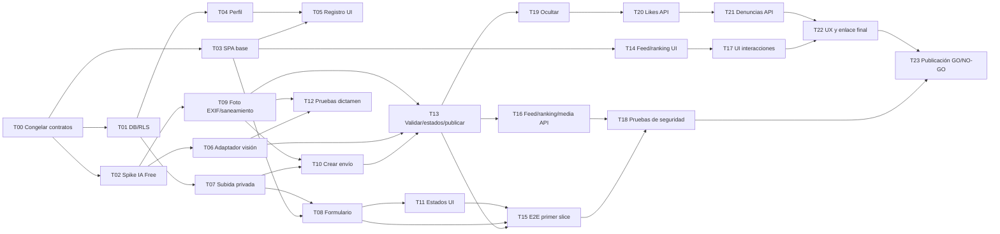

# Plan de implementación — Beta pública (5 horas)

**Estado:** planificación revisada con `planning-and-task-breakdown`; **pendiente de aprobación humana para iniciar implementación**. **Alcance:** beta pública aprobada, no los 91 RQ del producto completo. **Equipo:** Dev A (backend/datos), Dev B (frontend), Dev C (IA/seguridad/entrega), cada uno supervisando su agente. **Presupuesto:** cinco horas de reloj, incluidos QA y despliegue, no cinco horas exclusivamente de codificación.

## Objetivo y fuente de verdad

Entregar un recorrido real: ciudadano adulto crea cuenta (email + contraseña **sin confirmación**), adjunta foto reciente y descripción de reciclaje/recogida en municipio español, IA vision valida, una aprobación concede 10/20 puntos y publica evidencia saneada en feed, ranking global muestra puntos, y el usuario puede dar like, denunciar u ocultar su publicación con **revocación**. Los casos negativos no puntúan. Obligatorios: cooldown 60 min, EXIF de galería ≤60 min, máximo un envío no resuelto por usuario/tipo, fotos privadas, retirada y protección básica ante abuso. Una beta pública requiere GO humano; si falla un gate, solamente demo restringida.

La fuente funcional es `docs/ideas/product-concept.md` + `docs/specs/capability-map.md` + las cinco `SPEC-*.md`; técnica: `docs/design/{architecture,data-model,api-contracts,release-checklist}.md` y ADRs. `docs/requirements/mvp-requirements.md` contiene el producto completo; **no** autoriza añadir alcance futuro a esta iteración. Este plan determina orden y responsables, nunca contradice contratos aprobados. Rutas de código abajo son **previstas**, no rutas verificadas de un repositorio implementado.

## Arquitectura e invariantes de negocio

- SPA React/Vite/TS en Cloudflare Pages Free; Supabase Free para Auth/PostgreSQL/Storage/Edge Functions; Workers AI Free con modelo visual Gemma 4 **condicionado a prueba real de licencia, región, tratamiento y capacidad**. Ningún pago o activación de facturación.
- Cinco capacidades fijas: `identity`, `ai-validation`, `contributions`, `scoring`, `community`. DDD ligero: `Contribution` como agregado lógico, transiciones/invariantes ejecutadas transaccionalmente en Postgres; sin CQRS/event sourcing/microservicios.
- Lenguaje compartido: **contribución** (evidencia enviada), **dictamen IA** (plausibilidad, no prueba), **aprobada** (publicable/puntuable), **oculta** (`hidden_at`, revoca puntos sin restauración en beta), **cooldown** (desde `submitted_at` de última contribución aprobada, incluso oculta), **pendiente** (PENDING/NEEDS_EVIDENCE/TECHNICAL_ERROR), **imagen saneada** (copia sin EXIF/GPS servida únicamente si visible).
- El cliente no decide estado, puntuación, propiedad ni cooldown. Idempotencia y exclusión por usuario/tipo se imponen en DB. IA o saneamiento fallidos = **0 puntos y nada público**. Lecturas públicas nunca devuelven rutas privadas ni emails. Denuncias anónimas protegidas por CAPTCHA/rate-limit y atendibles por humano.

## Contratos, propiedad de archivos y forma de trabajo

| Persona/agente | Propiedad principal | No editar sin acuerdo |
|---|---|---|
| **A — dominio/backend** | `supabase/migrations/**`, `supabase/functions/api/index.ts`, `supabase/functions/api/routes/**`, `supabase/functions/api/domain/**`, `tests/api/**`, `tests/db/**` | `src/**`, `api/ai/**`, `api/media/**`, `e2e/**` |
| **B — experiencia web** | `src/**` (pantallas, componentes, cliente HTTP/SDK, pruebas de UI) | migraciones, backend, integraciones IA |
| **C — visión/QA/release** | `supabase/functions/api/ai/**`, `supabase/functions/api/media/**`, `tests/ai/**`, `tests/media/**`, `tests/security/**`, `e2e/**`, scripts/configuración de deployment bajo acuerdo | migraciones, `api/index.ts`, `api/routes/**`, `src/**` |

`docs/design/api-contracts.md` es el contrato estable: base `/functions/v1/api/v1`, DTO camelCase, enums UPPER_SNAKE, errores estructurados, JWT de Supabase, `Idempotency-Key`. **T00** acuerda adaptador `ValidationInput/ValidationResult` y nombres de módulos sin duplicar contratos en lugares incompatibles. Si aparece un conflicto sobre rutas o forma de respuesta, A es integrador de API, C dueño de adaptador, B consumidor: **primero actualizar spec/diseño y obtener acuerdo humano**, luego codificar.

Git: Trunk-Based Development, `task/Txx-*` de vida breve, PR pequeños; `main` siempre compilable. Prohibido modificar simultáneamente el mismo archivo. Integrar tras cada checkpoint. Mocks solamente en desarrollo/test, nunca como aprobación real en producción. No marcar casillas completas sin comando ejecutado y evidencia. Una sola persona integra cambios compartidos o de configuración global.

## Grafo de dependencias — bottom-up y slices verticales

**Dependencia de trabajo versus integración:** B puede preparar vistas con fixtures del contrato v1 mientras A implementa los endpoints. C puede probar modelos de IA antes de disponer de contribuciones. Cada slice solo se declara terminado cuando funciona con el backend real y pruebas correspondientes. No establecer dependencia falsa de disponer de todos los endpoints antes de empezar una pantalla.

## Secuencia y presupuesto por persona

| Tiempo de reloj | Dev A | Dev B | Dev C | Hito verificable |
|---|---|---|---|---|
| **00:00–00:15** | T00, acordar contratos y permisos | T00, confirmar DTO/UI | T00, acceso/coste/modelo | **H0:** interfaces y ownership congelados |
| **00:15–00:45** | T01 DB/RLS/Storage | T03 SPA | T02 spike IA | **CP1:** foundation + decisión preliminar IA |
| **00:45–01:25** | T04 perfil; iniciar T07 | T05 login | T06 adaptador | **CP2:** registro real + dictamen técnico estructurado |
| **01:25–02:05** | T07 subida, iniciar T10 | T08 contribución | T09 validación/saneamiento imagen | **CP3:** foto privada + interfaz funcional |
| **02:05–02:55** | Finalizar T10 y avanzar T13 | T11 estado, iniciar T14 | T12 dictamen/errores; iniciar T15 | **CP4:** pendiente real, invariantes mínimas |
| **02:55–03:40** | T13 aprobación + T16 lecturas | T14 feed/ranking, iniciar T17 | T15 E2E y preflight | **CP5:** primer flujo E2E aprobado/publicado/puntuado |
| **03:40–04:30** | T19 ocultar, T20 likes, T21 denuncias | T17 interacciones, T22 UX y móvil | T18 permisos, fallos, EXIF/cooldown hasta 04:15; predeploy | **CP6/7:** retirada, interacción, bloqueantes de seguridad verificados |
| **04:30–05:00** | Reparar bloqueantes; soporte release | Smoke móvil, detener nuevas features | T23 despliegue, ejecución de runbook | **H final:** decisión humana GO/NO-GO |

Son **presupuestos de coordinación, no garantías de duración**. No prometer 100% de funcionalidad ni beta pública si falta seguridad. La IA debe comprobarse **antes del minuto 45**; si falla, reexaminar la viabilidad en ese momento, no al final. Mantener un despliegue de staging anticipado en CP5 para no descubrir errores de configuración en el último minuto.

## Slices e hitos de revisión (cada 2–3 tareas)

| Checkpoint | Después de | Evidencia y decisión |
|---|---|---|
| **H0** | T00 | Cada rol acepta contract v1 y ownership; claves aprovisionadas manualmente sin Git |
| **CP1 (~00:45)** | T01–T03 | DB/RLS aplicable, shell compila, IA responde a imagen/texto en Free, términos revisados; **bloqueo inmediato** si IA no es usable |
| **CP2 (~01:25)** | T04–T06 | Registro/login real sin SMTP, alias único, municipios verificables, validación `APPROVED/NEEDS_EVIDENCE/REJECTED` estructurada |
| **CP3 (~02:05)** | T07–T09 | Subida exclusivamente privada, formulario cámara/galería, EXIF/imagen saneada probados |
| **CP4 (~02:55)** | T10–T12 | Crear envío idempotente, máximo un pendiente/tipo, cooldown 59/60 min, IA malformada/cuota no otorga puntos; UI muestra estados sin optimismo; recuperación backend se integra en T13 |
| **CP5 (~03:40)** | T13–T15 | Una acción real aprobada y publicada sin EXIF, score no duplicado, evidence/retry/cancel verificados y flujo E2E integrado en staging |
| **CP6 (~04:15)** | T16–T18 | Feed/ranking conectados, 401/403/RLS probados con clientes distintos, IA y medios no filtran secretos |
| **CP7 (~04:30)** | T19–T22 | Hide revoca puntos/retira media; likes no puntúan; denuncia con protección antiabuso; UX móvil funcional |
| **FINAL (~05:00)** | T23 | Lista `docs/design/release-checklist.md` + `tasks/release-runbook.md` con evidencia y GO/NO-GO humano |

Si una comprobación falla, la tarea vuelve a `BLOCKED` o `IN_REVIEW`; no arrastrar defectos a release. Dependencias reales se revisan tras cada checkpoint y tareas no desbloqueadas no se consideran completadas.

## Recortes y riesgos

**P0 para la beta pública:** todos los caminos de alta, foto/evidencia, IA, cooldown/EXIF, publicación y puntaje, feed/ranking, ocultación, likes/denuncia aprobados, controles de privacidad y seguridad. Prioridad en caso de retraso: **seguridad y recorrido núcleo antes que mejoras visuales**. Quitar una capacidad aprobada exige aprobación humana y actualización de specs (no ocultarlo en Planning).

| Riesgo | Severidad | Respuesta obligatoria |
|---|---|---|
| IA gratuita sin acceso real, licencia adecuada o capacidad | Crítico | T02 bloqueante; sin IA auténtica no hay beta pública; posible demo restringida sin engañar al jurado |
| Tratamiento externo de fotografías no resuelto | Crítico | No enviar fotos ciudadanas a IA ni desplegar beta hasta verificar términos y aviso adecuado |
| Inconsistencia de concurrencia/idempotencia/puntos | Alto | DB/SQL transaccional, pruebas carreras; no sumar saldos en UI ni confiar en `SELECT`+`INSERT` separados |
| Fotos originales expuestas o no saneadas | Crítico | Bucket privado, media proxy con control de visibilidad y `no-store`; publicar solo copia re-encodificada |
| Catálogo INE/Turnstile/registro real bloqueados | Alto | Preflight humano T00, registrar impedimentos, no inventar datos ni eludir antiabuso |
| Sin operador de denuncias/retiradas o aviso privacidad | Crítico | Designación humana antes de GO; verificación de retirada real desde consola |
| Retrasos por colisiones de agentes o configuración | Alto | Un dueño por ruta, contratos congelados, cambios pequeños, integrar cada checkpoint |
| Latencia/limitaciones `waitUntil`, cuotas Free, no durable queue | Alto | Estados persistidos y `/retry` correcto, fail closed; no prometer que un proceso pendiente terminará solo |

## Definition of Done / límites operativos

Una tarea se considera `DONE` solo si sus criterios comprobables están cubiertos, tiene prueba ejecutada o comprobación manual reproducible, PR/commit identificado y no rompe el build. Objetivo de scripts **a configurar/verificar** en implementación: `npm run build`, `npm run lint`, `npm test`, `npm run test:e2e` (no asumir que existen). E2E autorreal real y pruebas negativas obligatorias. `main` o rama de release concreta apuntan a commit verificable.

**Siempre:** validación externa de entradas/IA, RLS, secreto exclusivamente backend, idempotencia, error seguro, registro de hallazgos. **Consultar antes:** cambiar endpoint/schema/fuente de municipios, recortar alcance, proveedor de IA o configuración de pago. **Nunca:** comprometer secretos, eludir moderación para publicar, convertir timeout IA en aprobado, exponer fotos originales, desactivar RLS o lanzar beta sin aprobación humana.

## Preguntas operativas abiertas (no rediseñar producto)

- ¿Quiénes son A, B, C y el responsable humano GO/NO-GO/denuncias?
- ¿Cuentas Cloudflare/Supabase Free y Turnstile ya preparadas? ¿Existirá URL de staging para CP5?
- ¿Disponemos de un email de contacto operativo para avisos de privacidad y retirada? No se necesita dominio propio ni SMTP de registro.

**Estas preguntas se resuelven en T00 o bloquean GO según criticidad.** El diseño funcional y las especificaciones permanecen aprobados; esta revisión de Planning aún requiere visto bueno humano.
